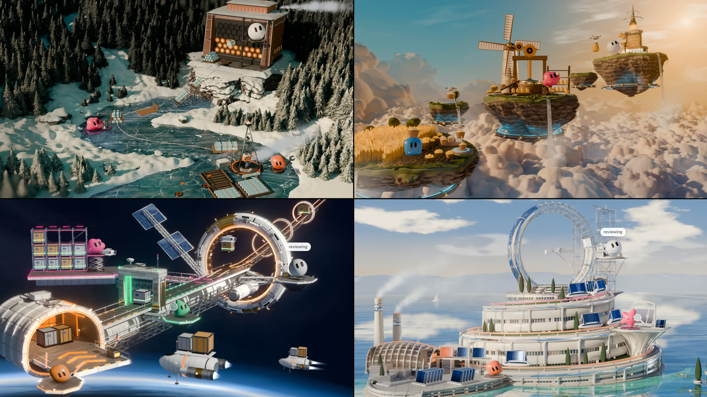

# Grok Bot Worlds



Live 3D worlds that show your team of AI bots at work.

- Each bot gets its own job in the world.
- See what each one is working on in real time.
- Finished work moves down the line to the next bot.
- Everything runs off what your bots are actually doing.

Free, and they adapt to your bots: a config file holds the names, colours and jobs, and nothing is tied to one team.

To set one up for your own bots, paste the block in [GROKBOT.md](GROKBOT.md) into your grok bot. To build a new world, read [engine/ISLAND_CONTRACT.md](engine/ISLAND_CONTRACT.md).

## Run

Needs Node 22 or newer.

```
npm install
npm run dev
```

Open http://localhost:3260. With no config it shows a bundled team that fits the island, running a made-up working day.

## The worlds

| World | Name in the config | Look | Team, counting the lead |
|---|---|---|---|
| [Arctic Grid](docs/arctic-grid.jpg) | `arctic-grid` | Polar dusk, a frozen river, an orange vault | 3 |
| [Hover Isles](docs/hover-isles.jpg) | `hover-isles` | Sunrise above the clouds, gold and cyan | 3 |
| [Orbit Port](docs/orbit-port.jpg) | `orbit-port` | A station in orbit over a glowing planet | 4 |
| [Chrome Citadel](docs/chrome-citadel.jpg) | `chrome-citadel` | Bright daylight, white and silver | 3 |

In the code each world is an island. Add `?island=<name>` to the address to pick one.

Open `/all.html` to see all four live at once, two rows of two, edge to edge, each panning on its own random camera.

On an upright phone the frame is too narrow for the whole line, so the camera moves to whichever bot just started working and stays at least 5 seconds. An approval request takes over at once.


## How the worlds move

Each island's world is one Cycles frame that comes alive in the browser. `stage.life()` moves the plate itself in the shader: plants bend from their base, water runs, clouds and their shadows travel, mist drifts, light sweeps along the structure. `stage.particles`, `flock`, `blink` and `chase` in `engine/plate/ambient.js` add weather, steam, birds and lights, depth tested against the frame. A plant's bend and phase come from a small extra Blender pass, `--passes motion`, which takes about 15 seconds and leaves the frame itself untouched.

`node tools/motion_map.mjs <island> <outdir>` measures it: the share of the frame moving, and a heat map where black means dead still.

## Switching things in the address

| Add to the address | What it does |
|---|---|
| `?island=orbit-port` | Pick the island. Beats the config. |
| `?config=example-3` | Bundled team of 3, counting the lead. Also `example-4`. |
| `?config=https://example.com/team.json` | Load a config from a URL. The host must allow cross site reads. |
| `?source=demo` | A believable working day on a loop. The default. |
| `?source=replay` | Saved events. Plays a built-in script for your team unless you add `&replay=` |
| `?source=replay&replay=examples/replay.example.json&speed=6` | Play a file at 1x to 20x. |
| `?source=live&live=<url>` | Poll a JSON URL every 3 s. |
| `?quality=phone` | Or `desktop`. Overrides the automatic pick. |
| `?daylight=0.8` | Pin the time of day, 0 to 1. |
| `?focus=main` | Start close on the main building, or on a bot id. Holds there, for look testing. |
| `?pull=0` | Stop the camera pulling toward events. |
| `?ui=1` | Show the corner panels, pile counts and camera buttons. Off by default. A problem with the feed always shows. |
| `?labels=0` | Hide the bubbles and the approval marker. |
| `?director=0` | Turn off the live view's camera. It pans slowly back and forth across the whole place by itself, with random timing, and gives way when you drag, scroll or click. |
| `?still=1` | Lock the camera's slow drift. `tools/motion_map.mjs` uses it to measure what really moves. |
| `?debug=1` | Frame rate box. Keys 1 to 5 fire idle, working, found, done and needs approval on one bot. Tab picks the next bot. These stay in the page. |

Without `?config=`, the page looks for `config.json` next to it (`public/config.json` in this project), then falls back to the bundled team. A config with problems shows a list of what to fix, rather than a broken scene.

## Config

```json
{
  "workspace": "my business name",
  "island": "orbit-port",
  "timezone": "America/New_York",
  "lead": { "id": "lead", "name": "lead", "role": "runs the team" },
  "bots": [
    { "id": "research", "name": "research", "role": "finds what buyers talk about", "color": "#3fd18b", "schedule": "mon, thu" }
  ],
  "source": { "mode": "live", "url": "https://YOUR-PROJECT.supabase.co/rest/v1/events", "anon_key": "the public anon key" }
}
```

A team is 3 or 4 counting the lead, so `bots` holds 2 or 3. List them in the order the work moves: the first bot starts the work, and the lead finishes it at the main building. `source` is optional and defaults to demo.

## Events

`bot_id`, `type`, `text`, `timestamp`, optional `value`. The types are `idle`, `working`, `found`, `done` and `needs_approval`.

- `needs_approval` stays until a later `done` from that bot.
- `found` takes an optional `value`. Larger values make a larger moment, on a log scale.
- The corner counts are for today in the config's time zone.

**Live mode** reads a plain list, `{"events":[...]}`, `{"data":[...]}`, or a Supabase table. It polls every 3 s, drops repeats, and backs off to once a minute with a visible status when the source fails.

**Replay files** are a list of events, or:

```json
{ "speed": 6, "loop": true, "lead_in": 1, "events": [ { "bot_id": "research", "type": "working", "text": "reading", "timestamp": "2026-03-16T15:00:00Z" } ] }
```

## Live events with Supabase

`supabase/setup.sql` makes one `events` table. Anyone with the page can read it. Writes only go through a function that checks a write key, and only the hash of that key is in the database. The key itself stays in the grok bot's secrets. The steps are in [GROKBOT.md](GROKBOT.md).

**Everything in that table is public to anyone with the page address.** Keep client names and private details out of event text.

The page never holds a write key and only sends GET requests. It also refuses to start with a Supabase secret key or service role key in the config or the address. Before any deploy:

```
npm run test:secrets
```

That proves its own patterns against fake keys, makes a build, then scans the build, `public/`, `islands/` and `engine/` for write keys, service role keys, other provider keys, non GET calls in the bundle, and third party reference images. It exits with an error if it finds any.

## Deploy as a static site

`npm run build` makes `dist/`, which is plain files with relative paths. It works at a domain root or in a sub folder.

The build ships each island's `scene.js`, its `islands/<name>/assets/`, and the mascots. It does not ship `references/`, `blender/`, or the dev placeholder island (once a real island exists).

**Vercel.** Import the project. Framework preset: Vite. Build command `npm run build`, output directory `dist`.

**Netlify.** Add the project. Build command `npm run build`, publish directory `dist`.

Or by hand, with either service's command line tool, deploy the `dist` folder.

Put your `config.json` in `public/` before building. It is public, so it holds only the anon key.

## Record a video from a replay

Recording steps time one frame at a time and never captures the screen in real time, so a slow frame cannot cause a stutter. Output is H.264 MP4 at exactly the frame rate asked for, and the tool checks that with `ffprobe` at the end.

```
node tools/record.mjs --island orbit-port --config example-4 --replay public/examples/replay.example.json --out out/orbit.mp4
```

That gives 20 seconds, 1920x1080, 60 fps, 1200 frames. Options: `--seconds`, `--fps`, `--width`, `--height`, `--speed`, `--quality`, `--daylight`, `--tour`, `--no-ui`, `--no-labels`. `--replay` and `--config` take a URL or a local file. The example replay file is written for `example-4`. Leave out `--replay` to use the built-in script, which works for any team, and leave out `--config` to get the bundled team that fits the island. Ask for a `found` with a large `value` late in the file if you want a big finish.

It starts its own server. It takes a few minutes for a light scene, and much longer for a heavy one, since each frame is rendered and saved in full. On a shared machine run it through `tools/gpu_slot.sh`.

To drive the clock yourself, open the page with `?capture=1`. Time, animation frames and `Math.random` then come only from `window.__step(dt)`. `window.__ready` turns true when it is safe to start.

## Tests

| Command | What it runs |
|---|---|
| `npm test` | Config, store, sources, camera clamp. Plain Node, no browser. |
| `npm run test:sql` | Runs `setup.sql` in PGlite and checks each role's access. |
| `npm run test:e2e` | Chromium through all five events in each source mode, on the placeholder island. Add `E2E_BUILD=1` to test the production build. Screenshots go to `.work/engine/shots/`. |
| `npm run test:secrets` | See above. |
| `node engine/test/check-island.mjs <name>` | One island against the contract: teams of 3 and 4, desktop and phone, all five events on every bot, every route, anchors and routes in frame, focus poses clear, real frame rate. It does not judge the look. |

The SQL test uses real Postgres compiled to WASM, not a Supabase project. It proves the table, policies and function, but not Supabase's API gateway or its handling of keys.

## Layout

```
index.html, vite.config.js, package.json
engine/            config, events, sources, camera, UI, quality, mascots wrapper, main loop
engine/ISLAND_CONTRACT.md   what an island must export
engine/plate/stage.js       the stage shipped islands stand on: Cycles plate, depth, live objects
islands/<name>/    scene.js and assets/
blender/           the Blender scripts that render each world's frame
docs/              the pictures in this README
islands/_placeholder/       dev only island used by the tests
assets/mascots/    the bots
public/            copied to the site as is
supabase/          setup.sql and its test
tools/             record.mjs, check-secrets.mjs
```

## Changing a world's look

Each world's frame is rendered in Blender from the script in `blender/<name>/`, all original geometry and materials made in code. You only need this to change how a world looks. `tools/render.sh <script> <out.png> <width> <samples> --plate islands/<name>/assets` renders a new frame and its depth into the world's assets. It looks for Blender at the usual macOS path; set `BLENDER` to point it somewhere else.

## License

MIT. Free to use, change and share.
